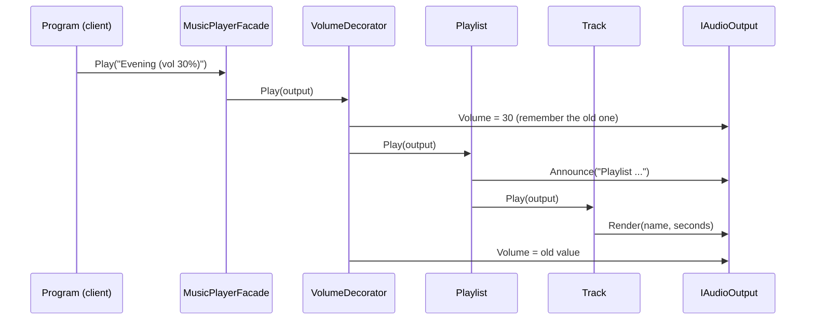
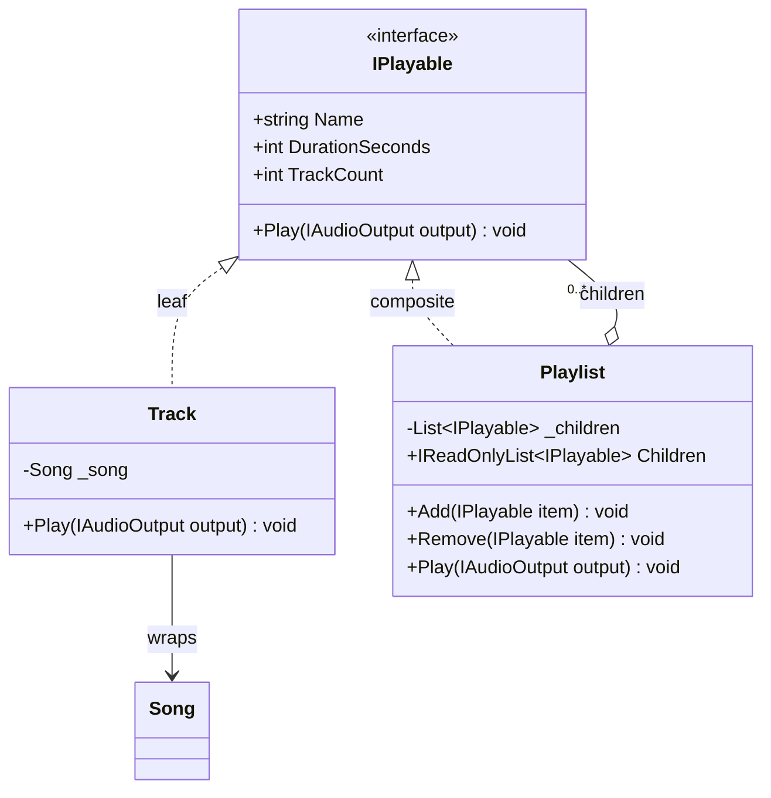
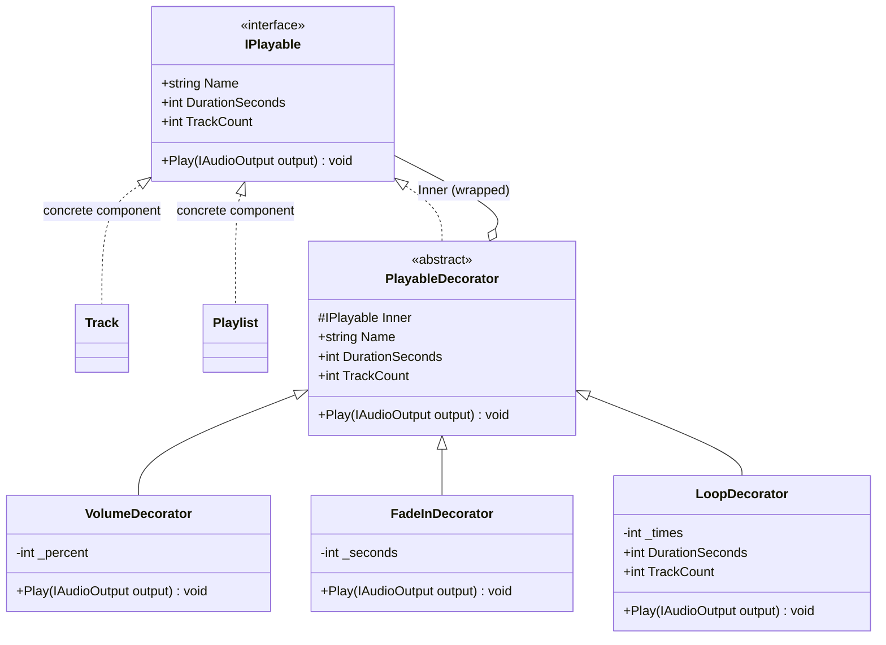
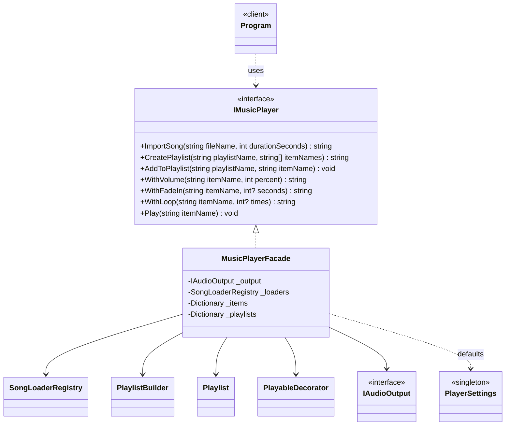

# Laboratory Work No. 2: Structural Design Patterns

**Course:** TMPS (Software Design Techniques and Mechanisms)
**Author:** Romanov Dana, FAF-241
**Language:** C# (.NET 8)

---

## 1. Domain description

The application is a console **music player**. It imports songs from file names such as `Taylor Swift - Love Story.mp3`, groups them into playlists (a playlist can contain songs and other playlists), applies effects (volume, fade-in, looping) to songs or whole playlists, and "plays" the result by printing each track with the volume and fade-in that are in effect. No audio is produced; the audio side is hidden behind the `IAudioOutput` interface, so a real device could be plugged in later.

The project continues the music domain from Lab 1 and reuses three creational patterns to create the objects the structural patterns work with:

| Lab 1 pattern | Class | What it creates here |
|---|---|---|
| Factory Method | `SongLoader` and `Mp3SongLoader`, `WavSongLoader`, `OggSongLoader` | `Song` subclasses, chosen by file extension |
| Builder | `PlaylistBuilder` | `Playlist` objects, step by step |
| Singleton | `PlayerSettings` | the single shared defaults (fade-in length, loop count) |

**Patterns implemented from this lab:** Composite, Decorator, Facade.

**One execution path through all three** (this is what the demo in `Program.cs` and the test `Facade_Passes_A_Decorated_Playlist_Through_Composite_And_Decorator` exercise):

```
Program -> IMusicPlayer (MusicPlayerFacade) -> VolumeDecorator -> Playlist -> Track -> IAudioOutput
```



---

## 2. Patterns

### 2.1 Composite

**Problem it solves here.** A playlist must be able to contain songs *and other playlists*, and the player should play, measure and count all of them the same way. Without Composite, the code that plays or sums a playlist would need to check "is this a song or a playlist?" at every level.

**Class diagram**



| Role | Class |
|---|---|
| Component | `IPlayable` |
| Leaf | `Track` |
| Composite | `Playlist` |

**Code** ([Structural/Composite/Playlist.cs](src/MusicPlayer/Structural/Composite/Playlist.cs))

```csharp
public int DurationSeconds => _children.Sum(child => child.DurationSeconds);

public int TrackCount => _children.Sum(child => child.TrackCount);

public void Add(IPlayable item)
{
    if (ReferenceEquals(item, this))
    {
        throw new ArgumentException("A playlist cannot contain itself.");
    }

    _children.Add(item);
}

public void Play(IAudioOutput output)
{
    output.Announce($"Playlist '{Name}': {TrackCount} track(s), {TimeFormat.Format(DurationSeconds)}");
    foreach (IPlayable child in _children)
    {
        child.Play(output);
    }
}
```

What makes it Composite: `Playlist` is itself an `IPlayable` and only talks to its children through that interface, so `Sum` and `Play` recurse through any depth of nesting without a single type check. `Add` and `Remove` live only on `Playlist`, so the client never needs them for playing.

**Unit tests** ([tests/MusicPlayer.Tests/CompositeTests.cs](tests/MusicPlayer.Tests/CompositeTests.cs))

| Test | What it checks |
|---|---|
| `Leaf_And_Group_Are_Used_Through_The_Same_Interface` | A `Track` and a `Playlist` placed in one `IPlayable[]` both report duration and track count through the interface. |
| `Nested_Playlist_Totals_Are_The_Sum_Of_All_Leaves` | A playlist containing a playlist reports 100 s and 4 tracks (the sum over all leaves). |
| `Playing_A_Nested_Playlist_Renders_Leaves_In_Order` | Playing the outer playlist produces the exact sequence of announcements and renders, in order. |
| `A_Playlist_Cannot_Contain_Itself` | Adding a playlist to itself throws `ArgumentException`. |

Test output (`dotnet test tests/MusicPlayer.Tests --filter FullyQualifiedName~CompositeTests --logger "console;verbosity=normal"`):

```
Test run for D:\tmps\lab2\tests\MusicPlayer.Tests\bin\Debug\net8.0\MusicPlayer.Tests.dll (.NETCoreApp,Version=v8.0)
  Passed MusicPlayer.Tests.CompositeTests.A_Playlist_Cannot_Contain_Itself [3 ms]
  Passed MusicPlayer.Tests.CompositeTests.Nested_Playlist_Totals_Are_The_Sum_Of_All_Leaves [3 ms]
  Passed MusicPlayer.Tests.CompositeTests.Leaf_And_Group_Are_Used_Through_The_Same_Interface [< 1 ms]
  Passed MusicPlayer.Tests.CompositeTests.Playing_A_Nested_Playlist_Renders_Leaves_In_Order [6 ms]
Test Run Successful.
Total tests: 4
     Passed: 4
 Total time: 0.5235 Seconds
```

---

### 2.2 Decorator

**Problem it solves here.** Effects (volume, fade-in, looping) must be combinable in any order, on a single song or a whole playlist, and chosen at runtime. A subclass per combination (`LoopedQuietTrack`, `QuietFadingPlaylist`, ...) would explode in number and could not be changed while the program runs.

**Class diagram**



| Role | Class |
|---|---|
| Component | `IPlayable` |
| Concrete components | `Track`, `Playlist` |
| Base decorator | `PlayableDecorator` |
| Concrete decorators | `VolumeDecorator`, `FadeInDecorator`, `LoopDecorator` |

**Code** ([Structural/Decorator/VolumeDecorator.cs](src/MusicPlayer/Structural/Decorator/VolumeDecorator.cs))

```csharp
public sealed class VolumeDecorator : PlayableDecorator
{
    private readonly int _percent;

    public VolumeDecorator(IPlayable inner, int percent) : base(inner)
    {
        if (percent < 0 || percent > 100)
        {
            throw new ArgumentOutOfRangeException(nameof(percent), "Volume must be between 0 and 100.");
        }

        _percent = percent;
    }

    public override string Name => $"{Inner.Name} (vol {_percent}%)";

    public override void Play(IAudioOutput output)
    {
        int previous = output.Volume;
        output.Volume = _percent;
        try
        {
            Inner.Play(output);
        }
        finally
        {
            output.Volume = previous;
        }
    }
}
```

What makes it Decorator: the class both *is* an `IPlayable` and *has* an `IPlayable` (`Inner`, held in the base class), and its `Play` calls the wrapped object while adding behavior around it. Because the wrapped object is typed as the interface, decorators can wrap tracks, playlists or other decorators. Restoring the old volume in `finally` is what allows a decorator inside another one to override the outer setting and still hand back the correct value.

**Unit tests** ([tests/MusicPlayer.Tests/DecoratorTests.cs](tests/MusicPlayer.Tests/DecoratorTests.cs))

| Test | What it checks |
|---|---|
| `Decorators_Can_Be_Stacked_In_Any_Order_With_The_Same_Result` | `Loop(Volume(track))` and `Volume(Loop(track))` both last 30 s and produce identical output events (3 renders at volume 80). |
| `Volume_Decorator_Applies_Its_Volume_And_Restores_The_Previous_One` | The track is rendered at volume 40 and the output is back at 100 afterwards. |
| `FadeIn_Decorator_Applies_Fade_And_Restores_The_Previous_One` | The track is rendered with fade 5 and the fade is 0 afterwards. |
| `Loop_Decorator_Multiplies_Duration_And_Track_Count` | A track of 10 s looped 4 times reports 40 s and 4 tracks. |
| `Decorating_Does_Not_Change_The_Wrapped_Object` | Wrapping leaves the original `Track` unchanged; the decorated name shows the stack. |
| `Volume_Decorator_Rejects_Values_Outside_0_To_100` | A volume of 101 throws `ArgumentOutOfRangeException`. |

Test output (`dotnet test tests/MusicPlayer.Tests --filter FullyQualifiedName~DecoratorTests --logger "console;verbosity=normal"`):

```
Test run for D:\tmps\lab2\tests\MusicPlayer.Tests\bin\Debug\net8.0\MusicPlayer.Tests.dll (.NETCoreApp,Version=v8.0)
  Passed MusicPlayer.Tests.DecoratorTests.Decorating_Does_Not_Change_The_Wrapped_Object [5 ms]
  Passed MusicPlayer.Tests.DecoratorTests.Decorators_Can_Be_Stacked_In_Any_Order_With_The_Same_Result [6 ms]
  Passed MusicPlayer.Tests.DecoratorTests.Loop_Decorator_Multiplies_Duration_And_Track_Count [< 1 ms]
  Passed MusicPlayer.Tests.DecoratorTests.Volume_Decorator_Rejects_Values_Outside_0_To_100 [< 1 ms]
  Passed MusicPlayer.Tests.DecoratorTests.Volume_Decorator_Applies_Its_Volume_And_Restores_The_Previous_One [< 1 ms]
  Passed MusicPlayer.Tests.DecoratorTests.FadeIn_Decorator_Applies_Fade_And_Restores_The_Previous_One [< 1 ms]
Test Run Successful.
Total tests: 6
     Passed: 6
 Total time: 0.5294 Seconds
```

---

### 2.3 Facade

**Problem it solves here.** To play a themed playlist, a caller would otherwise need to know five subsystems: the loader registry (to create songs), the builder (to assemble playlists), `Playlist`/`Track`, the decorators and the audio output. The facade gives the client one small interface, `IMusicPlayer`, in which everything is addressed by name.

**Class diagram**



| Role | Class |
|---|---|
| Client | `Program` |
| Facade (interface) | `IMusicPlayer` |
| Facade | `MusicPlayerFacade` |
| Subsystem | `SongLoaderRegistry`, `PlaylistBuilder`, `Playlist`, `Track`, the decorators, `IAudioOutput` |

**Code** ([Structural/Facade/MusicPlayerFacade.cs](src/MusicPlayer/Structural/Facade/MusicPlayerFacade.cs))

```csharp
public string ImportSong(string fileName, int durationSeconds)
{
    Song song = _loaders.Load(fileName, durationSeconds);      // Factory Method
    return Store(new Track(song));                              // Composite leaf
}

public string CreatePlaylist(string playlistName, params string[] itemNames)
{
    PlaylistBuilder builder = new PlaylistBuilder(_loaders).Named(playlistName);   // Builder
    foreach (string itemName in itemNames)
    {
        builder.Add(Find(itemName));
    }

    Playlist playlist = builder.Build();                        // Composite group
    _playlists[playlist.Name] = playlist;
    return Store(playlist);
}

public string WithFadeIn(string itemName, int? seconds = null)
{
    int length = seconds ?? PlayerSettings.Instance.DefaultFadeInSeconds;    // Singleton
    return Store(new FadeInDecorator(Find(itemName), length));
}

public void Play(string itemName)
{
    Find(itemName).Play(_output);
}
```

What makes it Facade: each method is one or two delegating calls into the subsystem. The facade owns no playlist logic, no effect logic and no output logic. It only keeps a name-to-item library, so it stays small and does not become a god class. The client (`Program.cs`) is typed against `IMusicPlayer` and never names a loader, builder, playlist or decorator.

**Unit tests** ([tests/MusicPlayer.Tests/FacadeTests.cs](tests/MusicPlayer.Tests/FacadeTests.cs))

The tests use `RecordingAudioOutput`, a stub of `IAudioOutput` that records every call.

| Test | What it checks |
|---|---|
| `Import_Build_And_Play_Run_The_Subsystem_In_The_Right_Order` | After import, build and play, the stub recorded the announcement first, then the two renders in order. |
| `Facade_Passes_A_Decorated_Playlist_Through_Composite_And_Decorator` | The pattern-interaction path: a volume-decorated playlist played through the facade renders at volume 50, and the output volume is restored. |
| `Playing_An_Unknown_Item_Throws` | Unknown names fail with `KeyNotFoundException`. |
| `Importing_An_Unsupported_Format_Throws` | A `.flac` file fails with `NotSupportedException` (no loader registered). |
| `Adding_To_A_Missing_Playlist_Throws` | `AddToPlaylist` on a name that is not a playlist throws `KeyNotFoundException`. |

Test output (`dotnet test tests/MusicPlayer.Tests --filter FullyQualifiedName~FacadeTests --logger "console;verbosity=normal"`):

```
Test run for D:\tmps\lab2\tests\MusicPlayer.Tests\bin\Debug\net8.0\MusicPlayer.Tests.dll (.NETCoreApp,Version=v8.0)
  Passed MusicPlayer.Tests.FacadeTests.Facade_Passes_A_Decorated_Playlist_Through_Composite_And_Decorator [12 ms]
  Passed MusicPlayer.Tests.FacadeTests.Adding_To_A_Missing_Playlist_Throws [< 1 ms]
  Passed MusicPlayer.Tests.FacadeTests.Import_Build_And_Play_Run_The_Subsystem_In_The_Right_Order [5 ms]
  Passed MusicPlayer.Tests.FacadeTests.Importing_An_Unsupported_Format_Throws [< 1 ms]
  Passed MusicPlayer.Tests.FacadeTests.Playing_An_Unknown_Item_Throws [< 1 ms]
Test Run Successful.
Total tests: 5
     Passed: 5
 Total time: 0.5722 Seconds
```

---

## 3. Reused creational patterns (Lab 1) and their tests

[tests/MusicPlayer.Tests/CreationalTests.cs](tests/MusicPlayer.Tests/CreationalTests.cs) covers the patterns the structural ones rely on: Singleton (same instance, no public constructor), Factory Method (right `Song` subclass per extension, default artist), extensibility (a test-only `.flac` loader is registered without editing any existing class) and Builder (order, reuse after `Build()`).

---

## 4. Requirements check

| Requirement | Where |
|---|---|
| Three structural patterns with full structure | Composite, Decorator (1 base + 3 concrete decorators), Facade |
| Patterns interact | Facade -> Decorator -> Composite (Section 1, and the interaction test) |
| Client depends on abstractions | `Program` uses `IMusicPlayer`; patterns use `IPlayable` and `IAudioOutput` |
| Open for extension | New decorator, format or output = new classes only (see README) |
| Builds on Lab 1 | Factory Method, Builder and Singleton are used by the facade |
| Clean structure | `Domain`, `Creational`, `Structural`, client in `Program.cs` |
| Runnable demo | `dotnet run --project src/MusicPlayer` |
| Unit tests, 2+ per pattern | 4 Composite, 6 Decorator, 5 Facade, 5 reused creational |

Demo output (`dotnet run --project src/MusicPlayer`):

```
1) Import files (Factory Method picks a loader from the extension)
   Love Story - Taylor Swift [MP3]
   Shake It Off - Taylor Swift [MP3]
   Blank Space - Taylor Swift [OGG]
   Going Up - Demo Artist [WAV]

2) Decorate (effects wrap an item and can be stacked in any order)
   Love Story - Taylor Swift [MP3] (vol 50%)
   Blank Space - Taylor Swift [OGG] (fade-in 3s)
   Going Up - Demo Artist [WAV] (vol 100%) (x2)

3) Build playlists (Builder) and nest them (Composite)
   Created 'Pop Hits' and 'Evening' (which contains 'Pop Hits')

4) Play 'Evening' (Facade -> Composite -> Decorators -> output)
Playlist 'Evening': 5 track(s), 11:43
  > Blank Space - Taylor Swift [OGG] [3:51] volume 80%, fade-in 3s
Playlist 'Pop Hits': 2 track(s), 7:34
  > Love Story - Taylor Swift [MP3] [3:55] volume 50%
  > Shake It Off - Taylor Swift [MP3] [3:39] volume 80%
  > Going Up - Demo Artist [WAV] [0:09] volume 100%
  > Going Up - Demo Artist [WAV] [0:09] volume 100%

5) Decorate a whole playlist: 'Evening' at 30% volume, played twice
Playlist 'Evening': 5 track(s), 11:43
  > Blank Space - Taylor Swift [OGG] [3:51] volume 30%, fade-in 3s
Playlist 'Pop Hits': 2 track(s), 7:34
  > Love Story - Taylor Swift [MP3] [3:55] volume 50%
  > Shake It Off - Taylor Swift [MP3] [3:39] volume 30%
  > Going Up - Demo Artist [WAV] [0:09] volume 100%
  > Going Up - Demo Artist [WAV] [0:09] volume 100%
Playlist 'Evening': 5 track(s), 11:43
  > Blank Space - Taylor Swift [OGG] [3:51] volume 30%, fade-in 3s
Playlist 'Pop Hits': 2 track(s), 7:34
  > Love Story - Taylor Swift [MP3] [3:55] volume 50%
  > Shake It Off - Taylor Swift [MP3] [3:39] volume 30%
  > Going Up - Demo Artist [WAV] [0:09] volume 100%
  > Going Up - Demo Artist [WAV] [0:09] volume 100%
```

---

## 5. Conclusions


- **What was harder than expected.** Deciding what a decorator should do to a playlist: the effect has to reach every track inside it, so the decorators change a setting on the shared `IAudioOutput` for the duration of the call and put it back afterwards. A second question was whether `WithVolume` should change an existing item or create a new one. Changing it would not update playlists that already contain the old object, so the facade creates a new library item instead.
- **What I would design differently.** The facade stores items by name, so two items with the same name overwrite each other, and a playlist that indirectly contains itself (A contains B contains A) is not detected, only the direct case. A real version would use ids and a cycle check. I would also add a `Proxy` for lazy or access-controlled loading of real audio files, and an `Adapter` around a real audio library or public API (advanced requirement A), which this version does not have.
