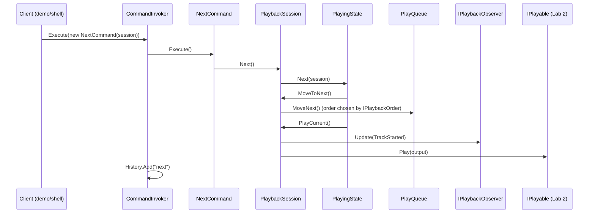
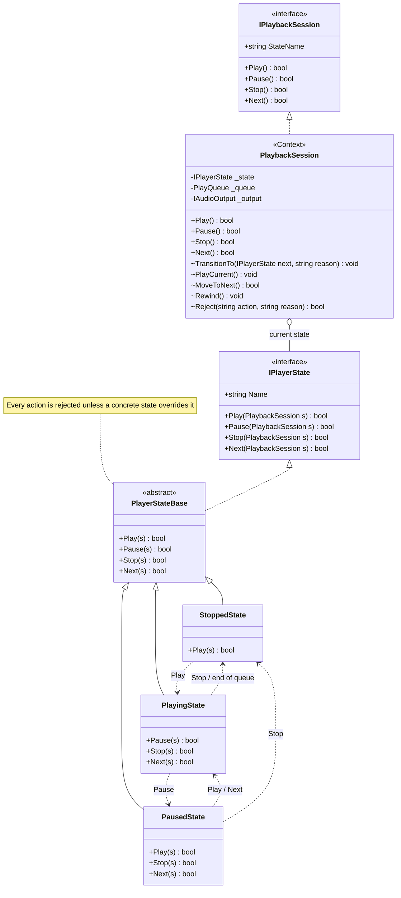
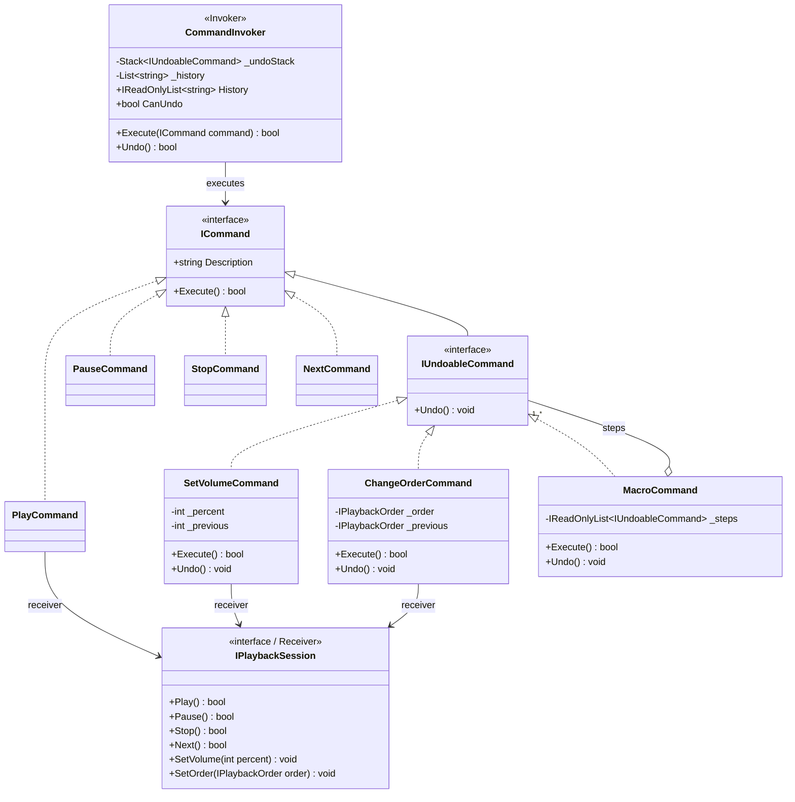
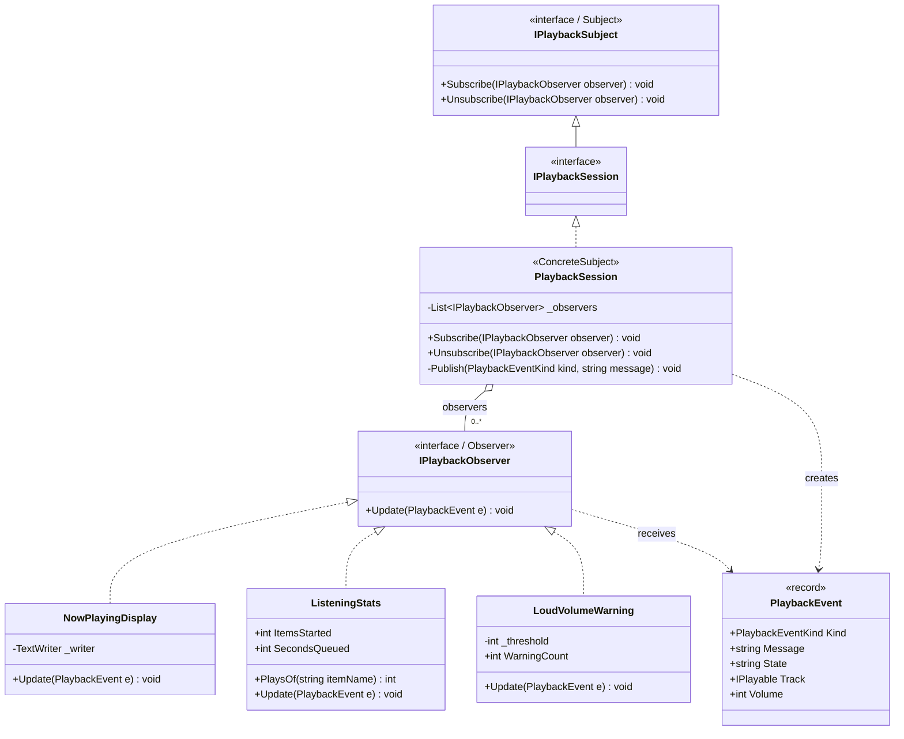
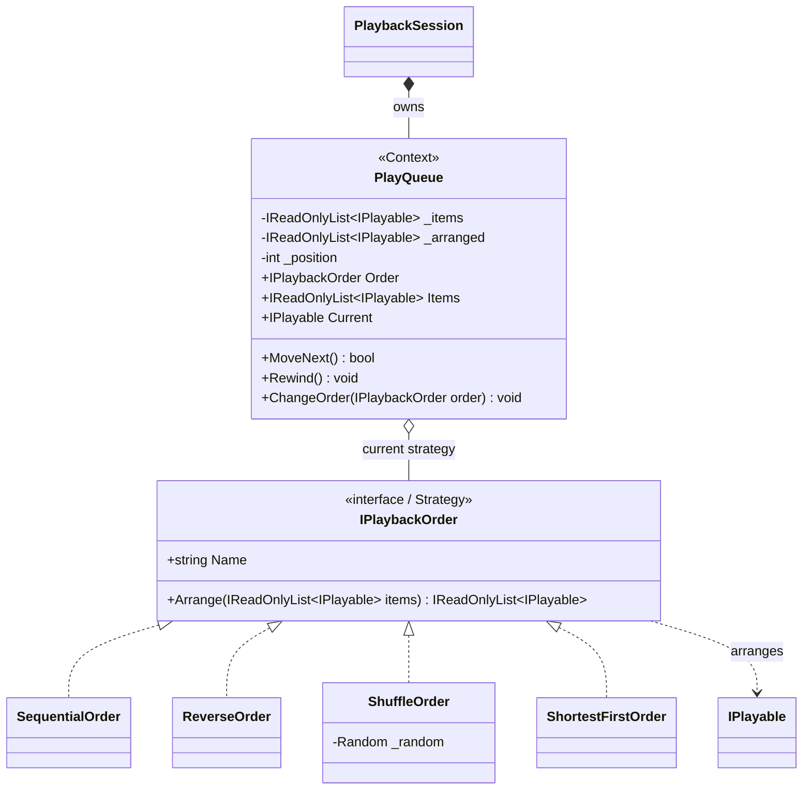

# Laboratory Work No. 3: Behavioral Design Patterns

**Course:** TMPS (Software Design Techniques and Mechanisms)
**Author:** Romanov Dana, FAF-241
**Language:** C# (.NET 8)

---

## 1. Domain description

The application is a console **music player**. Lab 2 built the music library: songs are imported from file names (Factory Method), grouped into nested playlists (Builder and Composite), given effects such as volume, fade-in and looping (Decorator), and everything is reached through one simple interface (Facade). The Lab 2 player could only play an item from start to end in a single call.

Lab 3 adds a **playback session** that the user controls step by step. You queue some library items, then press *play*, *pause*, *next* or *stop*, change the volume, switch the play order (sequential, reverse, shuffle, shortest first) and undo those changes. Several "screens" react to what happens: a now-playing display, listening statistics and a loud-volume warning. The demo is scripted (`dotnet run`). In interactive mode (`--interactive`) the user types the commands while the program runs.

**Behavioral patterns implemented:** State, Command, Observer, Strategy.
**Reused from earlier labs:** Facade, Composite, Decorator (Lab 2); Factory Method, Builder, Singleton (Lab 1).

| Pattern | Real problem it solves in this player |
|---|---|
| **State** | What *play*, *pause*, *next* and *stop* do depends on whether the player is stopped, playing or paused. Some actions are forbidden in some states. |
| **Command** | User actions must be logged in a history, and some must be undoable (volume, order, "party mode"). The remote control must not know what each action does. |
| **Observer** | Several independent parts (display, stats, hearing-safety warning) must react to playback changes. The user can switch them on and off while the program runs. |
| **Strategy** | The play order must be interchangeable and changeable mid-session without `if/else` on the order type. |

### How the patterns work together

The queue holds Lab 2 objects: a decorated song, a plain song and a whole playlist are all `IPlayable`. The facade opens the session. Every user action then goes through one path:

```
user input / demo
  -> ICommand (PlayCommand, SetVolumeCommand, ...)      COMMAND, run by CommandInvoker
    -> IPlaybackSession (PlaybackSession)                receiver = STATE context = OBSERVER subject
      -> IPlayerState (StoppedState / PlayingState / PausedState)   STATE decides
        -> PlayQueue -> IPlaybackOrder                   STRATEGY picks the next item
        -> IPlayable.Play(output)                        COMPOSITE + DECORATOR (Lab 2) play it
      -> IPlaybackObserver.Update(PlaybackEvent)         OBSERVERS are told what happened
```



The tests in [InteractionTests.cs](tests/MusicPlayer.Tests/Behavioral/InteractionTests.cs) cover this path, as does the demo.

### Project structure

```
src/MusicPlayer/
├── Program.cs              picks the client to run (from command-line args)
├── Client/                 CLIENT CODE: BehavioralDemo, InteractiveShell, StructuralDemo, FolderPlayer, DemoLibrary
├── Domain/                 Song models, IAudioOutput (console / speakers)
├── Creational/             Lab 1: Singleton, Factory Method, Builder
├── Structural/             Lab 2: Composite, Decorator, Facade
└── Behavioral/             Lab 3
    ├── State/              IPlaybackSession, PlaybackSession, IPlayerState, PlayerStateBase, 3 states
    ├── Command/            ICommand, IUndoableCommand, 6 commands, MacroCommand, CommandInvoker
    ├── Observer/           IPlaybackSubject, IPlaybackObserver, PlaybackEvent, 3 observers
    └── Strategy/           IPlaybackOrder, 4 orders, PlayQueue
tests/MusicPlayer.Tests/
├── Behavioral/             State, Command, Observer, Strategy and Interaction tests
└── *.cs                    Lab 2 tests (still passing)
```

---

## 2. Patterns

### 2.1 State

**Problem it solves here.** A music player behaves differently depending on its current state: *play* starts the queue when stopped, resumes when paused, and is meaningless when already playing. Without State, every method of the player would have a `switch (state)`, and adding a state (for example "Buffering") would mean editing all of them.

**Class diagram**



| Role | Class |
|---|---|
| Context | `PlaybackSession` (clients see it as `IPlaybackSession`) |
| State interface | `IPlayerState` |
| Shared default behavior | `PlayerStateBase` (every action rejected unless overridden) |
| Concrete states | `StoppedState`, `PlayingState`, `PausedState` |

Transition table (anything not listed is **rejected**: the state does not change and observers get an `ActionRejected` event):

| From \ action | Play | Pause | Stop | Next |
|---|---|---|---|---|
| **Stopped** | → Playing (from 1st item) | rejected | rejected | rejected |
| **Playing** | rejected | → Paused | → Stopped | next item, or → Stopped at end of queue |
| **Paused** | → Playing (resume) | rejected | → Stopped | → Playing next item, or → Stopped at end |

**Code** ([PlaybackSession.cs](src/MusicPlayer/Behavioral/State/PlaybackSession.cs), [PlayingState.cs](src/MusicPlayer/Behavioral/State/PlayingState.cs))

```csharp
// PlaybackSession: the context only delegates; there is no switch on the state.
public bool Play() => _state.Play(this);
public bool Pause() => _state.Pause(this);
public bool Stop() => _state.Stop(this);
public bool Next() => _state.Next(this);

internal void TransitionTo(IPlayerState next, string? reason = null)
{
    string previous = _state.Name;
    _state = next;
    string suffix = reason is null ? "" : $" ({reason})";
    Publish(PlaybackEventKind.StateChanged, $"{previous} -> {next.Name}{suffix}");
}

// PlayingState: the state decides what Next means and which state comes after.
public override bool Next(PlaybackSession session)
{
    if (session.MoveToNext())
    {
        session.PlayCurrent();
    }
    else
    {
        session.TransitionTo(new StoppedState(), "end of queue");
    }

    return true;
}
```

The context holds a reference to an `IPlayerState` and forwards every action to it. The transitions are written inside the state classes, not in the context or the client. `PlayerStateBase` rejects every action by default, so each state's overridden methods are exactly its allowed transitions, and a forbidden action can never fall through silently.

**Unit tests** ([StateTests.cs](tests/MusicPlayer.Tests/Behavioral/StateTests.cs))

| Test | What it checks |
|---|---|
| `Play_From_Stopped_Enters_Playing_And_Starts_The_First_Track` | Stopped → Play gives Playing, and exactly the first track is rendered. |
| `Pause_And_Resume_Move_Between_Playing_And_Paused_Without_Restarting_The_Track` | Playing ↔ Paused works both ways; resuming does not render the track again. |
| `Forbidden_Transitions_Are_Rejected_And_Leave_The_State_Unchanged` | Pause/Stop/Next in Stopped, Play in Playing and Pause in Paused all return `false`, keep the state and produce no sound. |
| `Next_After_The_Last_Item_Stops_The_Player` | At the end of the queue, Next moves Playing → Stopped. |
| `Next_While_Paused_Starts_The_Following_Item` | Paused → Next plays the next track and enters Playing. |
| `Stop_Then_Play_Starts_Again_From_The_First_Item` | Stopping rewinds the queue. |
| `Play_With_An_Empty_Queue_Is_Rejected` | The edge case is rejected safely, with no exception. |

```
Test run for d:\tmps\lab3\tests\MusicPlayer.Tests\bin\Debug\net8.0\MusicPlayer.Tests.dll (.NETCoreApp,Version=v8.0)
  Passed MusicPlayer.Tests.Behavioral.StateTests.Play_From_Stopped_Enters_Playing_And_Starts_The_First_Track [12 ms]
  Passed MusicPlayer.Tests.Behavioral.StateTests.Forbidden_Transitions_Are_Rejected_And_Leave_The_State_Unchanged [< 1 ms]
  Passed MusicPlayer.Tests.Behavioral.StateTests.Pause_And_Resume_Move_Between_Playing_And_Paused_Without_Restarting_The_Track [< 1 ms]
  Passed MusicPlayer.Tests.Behavioral.StateTests.Next_While_Paused_Starts_The_Following_Item [< 1 ms]
  Passed MusicPlayer.Tests.Behavioral.StateTests.Play_With_An_Empty_Queue_Is_Rejected [< 1 ms]
  Passed MusicPlayer.Tests.Behavioral.StateTests.Next_After_The_Last_Item_Stops_The_Player [3 ms]
  Passed MusicPlayer.Tests.Behavioral.StateTests.Stop_Then_Play_Starts_Again_From_The_First_Item [< 1 ms]
Test Run Successful.
Total tests: 7
     Passed: 7
```

---

### 2.2 Command

**Problem it solves here.** User actions arrive from different places: the scripted demo, the interactive shell, and in the future perhaps a GUI or keyboard shortcuts. They must be recorded in a history, and the changes to settings must be undoable, sometimes several at once ("party mode" = shuffle + volume 100). Turning each request into an object gives the invoker one uniform thing to run, log and undo.

**Class diagram**



(`PauseCommand`, `StopCommand` and `NextCommand` also hold an `IPlaybackSession`; their arrows are left out to keep the diagram readable.)

| Role | Class |
|---|---|
| Command | `ICommand`, `IUndoableCommand` |
| Concrete commands | `PlayCommand`, `PauseCommand`, `StopCommand`, `NextCommand`, `SetVolumeCommand`, `ChangeOrderCommand`, `MacroCommand` |
| Invoker | `CommandInvoker` |
| Receiver | `IPlaybackSession` (implemented by `PlaybackSession`) |
| Client | `BehavioralDemo`, `InteractiveShell` (create commands and hand them to the invoker) |

**Code** ([CommandInvoker.cs](src/MusicPlayer/Behavioral/Command/CommandInvoker.cs), [SetVolumeCommand.cs](src/MusicPlayer/Behavioral/Command/SetVolumeCommand.cs))

```csharp
// CommandInvoker: runs, logs and remembers commands without knowing what they do.
public bool Execute(ICommand command)
{
    bool done = command.Execute();
    _history.Add(done ? command.Description : $"{command.Description} (rejected)");

    if (done && command is IUndoableCommand undoable)
    {
        _undoStack.Push(undoable);
    }

    return done;
}

public bool Undo()
{
    if (!_undoStack.TryPop(out IUndoableCommand? command))
    {
        return false;
    }

    command.Undo();
    _history.Add($"undo {command.Description}");
    return true;
}

// SetVolumeCommand: the execute/undo pair. Changing the volume is the receiver's job.
public bool Execute()
{
    _previous = _session.Volume;
    _session.SetVolume(_percent);
    return true;
}

public void Undo() => _session.SetVolume(_previous);
```

The invoker depends only on `ICommand`. It keeps a history of every request and an undo stack of the undoable ones that succeeded, so a rejected command is never "undone". Each command stores only what it needs to reverse itself (`_previous`), and all the real work stays in the receiver. Transport commands are deliberately not undoable, because a track that was already heard cannot be un-heard. They still go through the invoker so they appear in the history.

**Unit tests** ([CommandTests.cs](tests/MusicPlayer.Tests/Behavioral/CommandTests.cs))

| Test | What it checks |
|---|---|
| `SetVolume_Then_Undo_Restores_The_Original_Volume` | Execute changes 70 → 20, and undo restores 70. |
| `ChangeOrder_Then_Undo_Restores_The_Previous_Strategy` | After undo, the session has the same strategy instance and the queue order as before. |
| `Undo_Reverses_The_Most_Recent_Command_First` | LIFO undo (60 → 30 → 100), then `Undo()` on an empty stack safely returns `false`. |
| `Rejected_Commands_Are_Logged_But_Not_Put_On_The_Undo_Stack` | A pause rejected by the State is logged as "pause (rejected)" and nothing becomes undoable. |
| `Macro_Command_Runs_All_Steps_And_One_Undo_Reverses_All_Of_Them` | "Party mode" changes order and volume, and one undo restores both. |
| `A_New_Command_Works_With_The_Invoker_Without_Changing_It` | A test-only `MuteCommand` is executed and undone by the unchanged invoker (open/closed). |

```
Test run for d:\tmps\lab3\tests\MusicPlayer.Tests\bin\Debug\net8.0\MusicPlayer.Tests.dll (.NETCoreApp,Version=v8.0)
  Passed MusicPlayer.Tests.Behavioral.CommandTests.SetVolume_Then_Undo_Restores_The_Original_Volume [12 ms]
  Passed MusicPlayer.Tests.Behavioral.CommandTests.ChangeOrder_Then_Undo_Restores_The_Previous_Strategy [12 ms]
  Passed MusicPlayer.Tests.Behavioral.CommandTests.Undo_Reverses_The_Most_Recent_Command_First [< 1 ms]
  Passed MusicPlayer.Tests.Behavioral.CommandTests.Rejected_Commands_Are_Logged_But_Not_Put_On_The_Undo_Stack [2 ms]
  Passed MusicPlayer.Tests.Behavioral.CommandTests.A_New_Command_Works_With_The_Invoker_Without_Changing_It [< 1 ms]
  Passed MusicPlayer.Tests.Behavioral.CommandTests.Macro_Command_Runs_All_Steps_And_One_Undo_Reverses_All_Of_Them [1 ms]
Test Run Successful.
Total tests: 6
     Passed: 6
```

---

### 2.3 Observer

**Problem it solves here.** The display, the listening statistics and the hearing-safety warning all need to know when the state, track, volume or order changes. If the session called them directly, it would depend on each of them, and adding a new one (for example a scrobbler) would mean editing the session. The user should also be able to switch them on and off while the player runs.

**Class diagram**



| Role | Class |
|---|---|
| Subject | `IPlaybackSubject` |
| Concrete subject | `PlaybackSession` |
| Observer | `IPlaybackObserver` |
| Concrete observers | `NowPlayingDisplay`, `ListeningStats`, `LoudVolumeWarning` |
| Notification data | `PlaybackEvent` (immutable record) |

**Code** ([PlaybackSession.cs](src/MusicPlayer/Behavioral/State/PlaybackSession.cs))

```csharp
public void Subscribe(IPlaybackObserver observer)
{
    ArgumentNullException.ThrowIfNull(observer);
    if (!_observers.Contains(observer))
    {
        _observers.Add(observer);
    }
}

public void Unsubscribe(IPlaybackObserver observer)
{
    _observers.Remove(observer);
}

private void Publish(PlaybackEventKind kind, string message)
{
    PlaybackEvent playbackEvent = new PlaybackEvent(kind, message, StateName, CurrentItem, Volume);

    // Iterate over a copy, so an observer may unsubscribe while it is being notified.
    foreach (IPlaybackObserver observer in _observers.ToArray())
    {
        observer.Update(playbackEvent);
    }
}
```

The subject knows its observers only as `IPlaybackObserver`, so adding a new observer needs no change here. Each observer receives an immutable `PlaybackEvent` with the facts. It does not get a reference to the player, so it cannot change the player from inside `Update` and start an endless update loop. The notify loop runs over a copy of the list, so subscribing or unsubscribing during a notification is safe.

**Unit tests** ([ObserverTests.cs](tests/MusicPlayer.Tests/Behavioral/ObserverTests.cs))

| Test | What it checks |
|---|---|
| `All_Subscribed_Observers_Are_Notified` | Two observers both receive `StateChanged` then `TrackStarted`, the same events in the same order. |
| `An_Unsubscribed_Observer_Is_Not_Notified` | After `Unsubscribe`, an observer gets nothing more; the remaining observer keeps receiving events. |
| `Subscribing_The_Same_Observer_Twice_Notifies_It_Once` | No duplicate notifications. |
| `An_Observer_Can_Unsubscribe_Itself_While_Being_Notified` | Removing an observer inside `Update` does not break the notify loop. |
| `Events_Carry_The_State_Track_And_Volume_At_That_Moment` | The event data is correct (state "Playing", track A, volume 60). |
| `Concrete_Observers_React_Only_To_Their_Events` | `ListeningStats` counts only started tracks (2 items, 40 s), and `LoudVolumeWarning` fires only above its threshold. |

```
Test run for d:\tmps\lab3\tests\MusicPlayer.Tests\bin\Debug\net8.0\MusicPlayer.Tests.dll (.NETCoreApp,Version=v8.0)
  Passed MusicPlayer.Tests.Behavioral.ObserverTests.An_Unsubscribed_Observer_Is_Not_Notified [9 ms]
  Passed MusicPlayer.Tests.Behavioral.ObserverTests.All_Subscribed_Observers_Are_Notified [12 ms]
  Passed MusicPlayer.Tests.Behavioral.ObserverTests.Concrete_Observers_React_Only_To_Their_Events [1 ms]
  Passed MusicPlayer.Tests.Behavioral.ObserverTests.Events_Carry_The_State_Track_And_Volume_At_That_Moment [1 ms]
  Passed MusicPlayer.Tests.Behavioral.ObserverTests.An_Observer_Can_Unsubscribe_Itself_While_Being_Notified [< 1 ms]
  Passed MusicPlayer.Tests.Behavioral.ObserverTests.Subscribing_The_Same_Observer_Twice_Notifies_It_Once [< 1 ms]
Test Run Successful.
Total tests: 6
     Passed: 6
```

---

### 2.4 Strategy

**Problem it solves here.** The user wants to choose how the queue is played: in order, reversed, shuffled or shortest first. The choice must be possible mid-session. Writing this as `if (mode == "shuffle") ... else if ...` inside the queue would mean editing the queue for every new order.

**Class diagram**



| Role | Class |
|---|---|
| Context | `PlayQueue` (owned by `PlaybackSession`, which exposes `SetOrder`) |
| Strategy | `IPlaybackOrder` |
| Concrete strategies | `SequentialOrder`, `ReverseOrder`, `ShuffleOrder`, `ShortestFirstOrder` |

**Code** ([PlayQueue.cs](src/MusicPlayer/Behavioral/Strategy/PlayQueue.cs), [ShortestFirstOrder.cs](src/MusicPlayer/Behavioral/Strategy/ShortestFirstOrder.cs))

```csharp
// PlayQueue (context): asks the current strategy for the order; never checks which strategy it is.
public PlayQueue(IEnumerable<IPlayable> items, IPlaybackOrder order)
{
    _items = (items ?? throw new ArgumentNullException(nameof(items))).ToList();
    Order = order ?? throw new ArgumentNullException(nameof(order));
    _arranged = order.Arrange(_items);
}

/// Swaps the strategy at runtime. The current item stays current;
/// what comes after it follows the new order.
public void ChangeOrder(IPlaybackOrder order)
{
    IPlayable? current = Current;
    Order = order ?? throw new ArgumentNullException(nameof(order));
    _arranged = order.Arrange(_items);
    _position = current is null ? 0 : Math.Max(0, PositionOf(current));
}

// ShortestFirstOrder (one concrete strategy).
public IReadOnlyList<IPlayable> Arrange(IReadOnlyList<IPlayable> items)
{
    return items.OrderBy(item => item.DurationSeconds).ToList();
}
```

All orders share the single `Arrange` signature, and the context stores its strategy as `IPlaybackOrder`. Switching the order is therefore one assignment with no conditionals. The context always arranges the original, untouched list (`_items`), so swapping order many times never loses or duplicates an item. Because strategies receive Lab 2 `IPlayable`s, `ShortestFirstOrder` measures a whole playlist or a looped track by its total length for free.

**Unit tests** ([StrategyTests.cs](tests/MusicPlayer.Tests/Behavioral/StrategyTests.cs))

| Test | What it checks |
|---|---|
| `Each_Order_Arranges_The_Queue_As_Expected` | Sequential A B C, Reverse C B A, ShortestFirst A C B for tracks of 10/30/20 s. |
| `Shuffle_Is_A_Permutation_And_Repeatable_With_The_Same_Seed` | Shuffle keeps every item exactly once, and the same seed gives the same order. |
| `Arranging_Does_Not_Modify_The_Input_List` | Strategies return a new list and do not reorder the caller's list. |
| `Shortest_First_Measures_Decorated_And_Nested_Items_By_Their_Total_Length` | A playlist (10 s) < a track (15 s) < a track looped 5× (20 s): the strategy works on Composite and Decorator objects. |
| `Swapping_The_Order_At_Runtime_Changes_What_Plays_Next` | While A plays, switching to shortest-first makes Next play C instead of B. |

```
Test run for d:\tmps\lab3\tests\MusicPlayer.Tests\bin\Debug\net8.0\MusicPlayer.Tests.dll (.NETCoreApp,Version=v8.0)
  Passed MusicPlayer.Tests.Behavioral.StrategyTests.Swapping_The_Order_At_Runtime_Changes_What_Plays_Next [13 ms]
  Passed MusicPlayer.Tests.Behavioral.StrategyTests.Shortest_First_Measures_Decorated_And_Nested_Items_By_Their_Total_Length [1 ms]
  Passed MusicPlayer.Tests.Behavioral.StrategyTests.Shuffle_Is_A_Permutation_And_Repeatable_With_The_Same_Seed [< 1 ms]
  Passed MusicPlayer.Tests.Behavioral.StrategyTests.Arranging_Does_Not_Modify_The_Input_List [< 1 ms]
  Passed MusicPlayer.Tests.Behavioral.StrategyTests.Each_Order_Arranges_The_Queue_As_Expected [< 1 ms]
Test Run Successful.
Total tests: 5
     Passed: 5
```

---

### 2.5 Pattern interaction tests

[InteractionTests.cs](tests/MusicPlayer.Tests/Behavioral/InteractionTests.cs) opens the session through the Lab 2 facade and drives it only through commands:

| Test | Path it proves |
|---|---|
| `A_Command_Changes_The_State_Observers_Hear_About_It_And_The_Decorated_Item_Plays` | Facade → `PlayCommand` → `CommandInvoker` → `PlaybackSession` → `StoppedState` → observer gets "Stopped -> Playing" → `VolumeDecorator` renders at 40% and restores 100%. |
| `Next_Plays_A_Whole_Playlist_As_One_Queue_Item` | `NextCommand` → `PlayingState` → `PlayQueue` → a `Playlist` (Composite) plays its children, including a `FadeInDecorator`. |
| `Undoing_A_Strategy_Change_Is_Announced_To_Observers` | `ChangeOrderCommand` + undo → Strategy swapped twice → two `OrderChanged` events → history logged. |

```
Test run for d:\tmps\lab3\tests\MusicPlayer.Tests\bin\Debug\net8.0\MusicPlayer.Tests.dll (.NETCoreApp,Version=v8.0)
  Passed MusicPlayer.Tests.Behavioral.InteractionTests.A_Command_Changes_The_State_Observers_Hear_About_It_And_The_Decorated_Item_Plays [13 ms]
  Passed MusicPlayer.Tests.Behavioral.InteractionTests.Undoing_A_Strategy_Change_Is_Announced_To_Observers [12 ms]
  Passed MusicPlayer.Tests.Behavioral.InteractionTests.Next_Plays_A_Whole_Playlist_As_One_Queue_Item [2 ms]
Test Run Successful.
Total tests: 3
     Passed: 3
```

Whole suite (`dotnet test tests/MusicPlayer.Tests`):

```
Passed!  - Failed:     0, Passed:    49, Skipped:     0, Total:    49, Duration: 49 ms - MusicPlayer.Tests.dll (net8.0)
```

---

## 3. The other behavioral patterns (not implemented)

| Pattern | Where it would fit in this player, or why it was not used |
|---|---|
| Chain of Responsibility | Importing files: a chain of handlers (`Mp3Handler → WavHandler → UnsupportedHandler`) could each decide whether to handle a file. The Lab 1 `SongLoaderRegistry` already solves this with a dictionary lookup, which is simpler for one-to-one matches. |
| Iterator | A depth-first iterator over the nested `Playlist` tree could yield leaf tracks one by one. The queue here is flat (top-level items), so the built-in list traversal is enough. |
| Mediator | Useful with a GUI: buttons, a progress bar and a volume slider would talk through a mediator instead of to each other. A console app has no such colleagues. |
| Memento | Could save and restore a whole session (queue position, order, volume) as an opaque snapshot, for example "resume where I left off". Command's per-action undo covered the undo needs of this lab. |
| Template Method | A `SongLoader.Load` skeleton (parse name → `CreateSong` → set path) is close to it already: the base class fixes the steps and subclasses fill one in. |
| Visitor | Operations over the Composite tree (export to M3U, compute statistics) without editing `Track`/`Playlist`. That pays off only if the class hierarchy is stable and operations are added often. |
| Interpreter | A tiny query language such as `artist = "Taylor Swift" and duration < 4:00` could be parsed into an expression tree to build smart playlists. |

---

## 4. Requirements check

| Requirement | Where |
|---|---|
| 3+ behavioral patterns, full structure | State (context + interface + 3 states with transitions), Command (2 interfaces, 7 commands, invoker, receiver), Observer (subject + observer interfaces, 3 observers, subscribe/unsubscribe), Strategy (context + interface + 4 strategies) |
| Patterns interact | Command → State → Strategy + Composite/Decorator → Observer, on every action (Section 1, `InteractionTests`) |
| Client depends on abstractions | Clients use `IMusicPlayer`, `IPlaybackSession`, `ICommand`, `IPlaybackOrder`, `IPlaybackObserver`; the invoker knows only `ICommand`; the session knows only `IPlayerState`, `IPlaybackObserver` and `IPlaybackOrder` |
| Open for extension | New command / order / observer / state = a new class (see README "Extending it"); `A_New_Command_Works_With_The_Invoker_Without_Changing_It` proves it for commands |
| Builds on Lab 2 | The queue items are Composite/Decorator objects; the session is opened through the Facade; songs come from the Factory Method; defaults from the Singleton |
| Clean structure | `Domain/`, `Creational/`, `Structural/`, `Behavioral/<Pattern>/`, `Client/`, tests in their own project |
| Runnable demo | `dotnet run --project src/MusicPlayer` (output below) |
| **A. Behavior changes at runtime** | `--interactive`: the user switches strategy (`order shuffle`), moves between states, subscribes/unsubscribes observers (`watch stats`, `unwatch display`), undoes |
| **B. Unit tests** | 7 State, 6 Command, 6 Observer, 5 Strategy, 3 interaction (plus 22 Lab 1/2 tests) |

### Demo output (`dotnet run --project src/MusicPlayer`)

```
1) Queue built with the Lab 2 facade (songs, decorated songs, a nested playlist)
   1. Love Story - Taylor Swift [MP3] (vol 50%)
   2. Shake It Off - Taylor Swift [MP3]
   3. Blank Space - Taylor Swift [OGG] (fade-in 3s)
   4. Demo Loops

2) Observers subscribe at runtime
   subscribed: display, stats, loud-volume warning

3) Commands drive the State machine (Stopped -> Playing -> Paused -> Playing)
> play
   [player] Stopped -> Playing
   [now playing] Love Story - Taylor Swift [MP3] (vol 50%)
  > Love Story - Taylor Swift [MP3] [3:55] volume 50%
> pause
   [player] Playing -> Paused
> pause
   [rejected] Cannot pause: the player is paused
> play
   [player] Paused -> Playing (resumed)
> next
   [now playing] Shake It Off - Taylor Swift [MP3]
  > Shake It Off - Taylor Swift [MP3] [3:39] volume 80%

4) Undoable command: volume (the warning observer reacts)
> volume 95%
   [volume] Volume set to 95%
   [warning] Volume 95% is above 85%: protect your hearing!
> undo
   [volume] Volume set to 80%

5) Strategy swapped at runtime: shortest first
> order shortest first
   [order] Order 'shortest first': Demo Loops, Shake It Off - Taylor Swift [MP3], Blank Space - Taylor Swift [OGG] (fade-in 3s), Love Story - Taylor Swift [MP3] (vol 50%)
> next
   [now playing] Blank Space - Taylor Swift [OGG] (fade-in 3s)
  > Blank Space - Taylor Swift [OGG] [3:51] volume 80%, fade-in 3s
> undo
   [order] Order 'sequential': Love Story - Taylor Swift [MP3] (vol 50%), Shake It Off - Taylor Swift [MP3], Blank Space - Taylor Swift [OGG] (fade-in 3s), Demo Loops

6) Stats observer unsubscribes; macro command 'party mode' (shuffle + volume 100)
   unsubscribed: stats
> party mode
   [order] Order 'shuffle': Love Story - Taylor Swift [MP3] (vol 50%), Demo Loops, Blank Space - Taylor Swift [OGG] (fade-in 3s), Shake It Off - Taylor Swift [MP3]
   [volume] Volume set to 100%
   [warning] Volume 100% is above 85%: protect your hearing!
> next
   [now playing] Shake It Off - Taylor Swift [MP3]
  > Shake It Off - Taylor Swift [MP3] [3:39] volume 100%
> undo
   [volume] Volume set to 80%
   [order] Order 'sequential': Love Story - Taylor Swift [MP3] (vol 50%), Shake It Off - Taylor Swift [MP3], Blank Space - Taylor Swift [OGG] (fade-in 3s), Demo Loops

7) Play to the end of the queue, then forbidden actions are rejected
> next
   [now playing] Blank Space - Taylor Swift [OGG] (fade-in 3s)
  > Blank Space - Taylor Swift [OGG] [3:51] volume 80%, fade-in 3s
> next
   [now playing] Demo Loops
Playlist 'Demo Loops': 3 track(s), 0:30
  > Going Up - Demo Artist [WAV] [0:09] volume 80%
  > Going Up - Demo Artist [WAV] [0:09] volume 80%
  > Wobble - Demo Artist [WAV] [0:12] volume 80%
> next
   [player] Playing -> Stopped (end of queue)
> pause
   [rejected] Cannot pause: the player is stopped
> stop
   [rejected] Cannot stop: the player is stopped

8) Command history (invoker) and listening stats (observer)
   history: play | pause | pause (rejected) | play | next | volume 95% | undo volume 95% | order shortest first | next | undo order shortest first | party mode | next | undo party mode | next | next | next | pause (rejected) | stop (rejected)
   stats: 3 item(s) started, 11:25 of music (counted only while subscribed)
```

### Interactive mode (`dotnet run --project src/MusicPlayer -- --interactive`), excerpt

The typed commands are shown after each `>` prompt.

```
[Stopped, vol 80%, sequential] > play
   [player] Stopped -> Playing
   [now playing] Love Story - Taylor Swift [MP3] (vol 50%)
  > Love Story - Taylor Swift [MP3] [3:55] volume 50%
[Playing, vol 80%, sequential] > watch loud
   'loud' subscribed
[Playing, vol 80%, sequential] > order shortest
   [order] Order 'shortest first': Demo Loops, Shake It Off - Taylor Swift [MP3], Blank Space - Taylor Swift [OGG] (fade-in 3s), Love Story - Taylor Swift [MP3] (vol 50%)
[Playing, vol 80%, shortest first] > vol 90
   [volume] Volume set to 90%
   [warning] Volume 90% is above 85%: protect your hearing!
[Playing, vol 90%, shortest first] > undo
   [volume] Volume set to 80%
[Playing, vol 80%, shortest first] > unwatch display
   'display' unsubscribed
[Playing, vol 80%, shortest first] > pause
[Paused, vol 80%, shortest first] > pause
[Paused, vol 80%, shortest first] > history
   play | order shortest first | volume 90% | undo volume 90% | pause | pause (rejected)
```

---

## 5. Conclusions

- **What was harder than expected.**
  - *Fitting a step-by-step player onto the Lab 2 model.* In Lab 2, `IPlayable.Play` plays a whole item, and decorators apply their effect only during that call. Flattening playlists into single tracks for the queue would have lost the effects set on a playlist. So a queue entry is any `IPlayable`, and a playlist in the queue plays as one entry.
  - *Who owns the transitions in State.* The states need to change the context, but those operations (`TransitionTo`, `PlayCurrent`) must not be callable by clients. Making them `internal` and exposing clients only to `IPlaybackSession` solved it.
  - *Changing strategy mid-play.* The current track has to stay current while the rest of the queue is reordered around it.
  - *Commands that the State rejects.* These must not end up on the undo stack, which is why `Execute` returns `bool`.
- **What I would design differently.**
  - Transport commands are not undoable. A Memento of the whole session (position, state, order, volume) would let "undo next" work too.
  - `PlaybackSession` is both the State context and the Observer subject. With more event types, I would move publishing into a separate event-hub class so the session stays small.
  - Rejection is reported as `bool` plus an `ActionRejected` event. A richer result type (with the reason) would make the API more explicit than a bare `false`.
  - Playback is simulated: a track "plays" instantly in the console. A real player would need a timer and a `Finished` event to call `Next` automatically.
